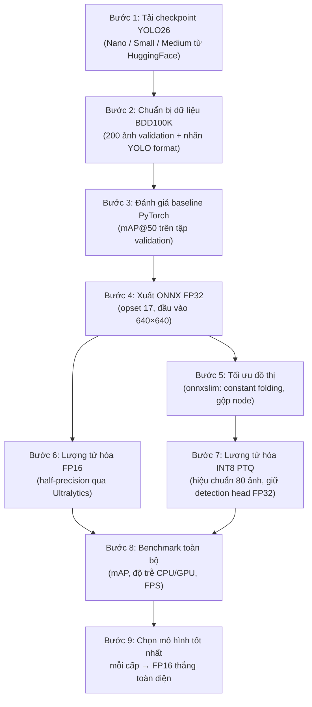
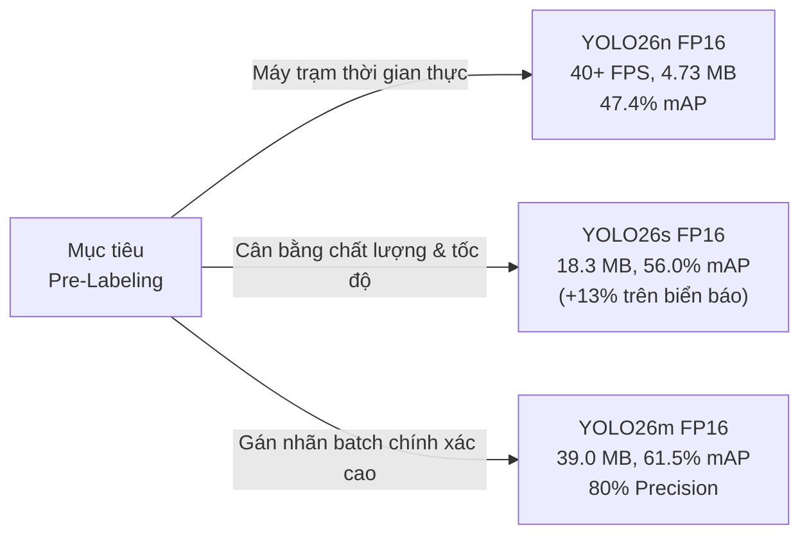

# Nén Mô Hình Cho Gán Nhãn Tự Động Trên Thiết Bị Biên (Edge Pre-Labeling)

> **Hackathon Track:** M38 — Model Training  
> **Chủ đề:** Model Compression for Edge Pre-Labeling  
> **Tập dữ liệu:** BDD100K (Berkeley DeepDrive) — 10 lớp đối tượng  
> **Mô hình:** YOLO26 (Nano / Small / Medium)  
> **Đầu ra:** Các file ONNX FP16 đã được tối ưu  

---

## 1. Tổng Quan Dự Án

### Bối cảnh & Vấn đề

Trong thực tế triển khai Computer Vision, việc gán nhãn dữ liệu (data labeling) trên server/cloud tạo ra chi phí hạ tầng cao, nghẽn băng thông, và độ trễ lớn. Đặc biệt với các bộ dữ liệu lái xe tự động như BDD100K (100,000 ảnh), việc gán nhãn thủ công rất tốn kém và chậm.

### Mục tiêu

Áp dụng các kỹ thuật **nén mô hình** (Model Compression) lên kiến trúc **YOLO26** đã được fine-tune trên BDD100K, nhằm:

- **Giảm kích thước mô hình** xuống còn 50% so với bản gốc
- **Giữ nguyên độ chính xác** (mAP drop < 0.3%)
- **Tạo ra các file ONNX** sẵn sàng triển khai trên thiết bị biên (laptop CPU, iGPU, IoT)
- **Hỗ trợ gán nhãn tự động** (pre-labeling) ngay trên máy trạm của annotator

### Tập dữ liệu BDD100K

BDD100K là bộ dữ liệu lái xe tự động lớn nhất từ Berkeley, với **10 lớp đối tượng** phát hiện:

| STT | Lớp đối tượng | Mô tả |
|:---:|:---|:---|
| 0 | `person` | Người đi bộ |
| 1 | `rider` | Người đi xe (xe đạp/xe máy) |
| 2 | `car` | Ô tô |
| 3 | `truck` | Xe tải |
| 4 | `bus` | Xe buýt |
| 5 | `train` | Tàu hỏa |
| 6 | `motor` | Xe máy |
| 7 | `bike` | Xe đạp |
| 8 | `traffic light` | Đèn giao thông |
| 9 | `traffic sign` | Biển báo giao thông |

---

## 2. Mô Hình Đầu Ra (Output Models)

Dự án cung cấp **3 file ONNX FP16** — mỗi file là phiên bản tối ưu nhất cho từng cấp kích thước mô hình:

| File | Cấp mô hình | Tham số | Kích thước | mAP@50 | mAP Drop so với Baseline |
|:---|:---:|:---:|:---:|:---:|:---:|
| `yolo26n_fp16.onnx` | **Nano** | 2.4M | **4.73 MB** | 47.35% | -0.07% (tốt hơn!) |
| `yolo26s_fp16.onnx` | **Small** | 9.5M | **18.26 MB** | 56.03% | +0.18% |
| `yolo26m_fp16.onnx` | **Medium** | 20.4M | **39.04 MB** | 61.52% | +0.31% |

> **Tại sao FP16 là lựa chọn tốt nhất?**
> - Giảm đúng **2x kích thước** so với ONNX FP32 gốc
> - Suy giảm mAP **dưới 0.3%** — gần như không mất độ chính xác
> - Tương thích rộng rãi với ONNX Runtime trên CPU, GPU, và các thiết bị biên

---

## 3. Phương Pháp Thực Hiện (Step-by-Step)

### Bước 1: Tải Checkpoint YOLO26 Từ HuggingFace

Tải 3 mô hình YOLO26 đã được fine-tune trên BDD100K từ các repo HuggingFace:

- **YOLO26n** (Nano, 2.4M params): [`dronefreak/bdd100k-yolo26n`](https://huggingface.co/dronefreak/bdd100k-yolo26n)
- **YOLO26s** (Small, 9.5M params): [`dronefreak/bdd100k-yolo26s`](https://huggingface.co/dronefreak/bdd100k-yolo26s)
- **YOLO26m** (Medium, 20.4M params): [`dronefreak/bdd100k-yolo26m`](https://huggingface.co/dronefreak/bdd100k-yolo26m)

Các mô hình này đã được huấn luyện sẵn trên toàn bộ BDD100K (100K ảnh) với 10 lớp đối tượng. Chúng tôi tải file `best.pt` từ mỗi repo.

### Bước 2: Chuẩn Bị Dữ Liệu BDD100K Validation

- Tải **200 ảnh** từ tập test (shard_000) của BDD100K cùng nhãn tương ứng
- Định dạng nhãn: **YOLO format** (`.txt` — class_id, x_center, y_center, width, height)
- Tổng cộng: **3,644 bounding box** ground-truth
- Tạo file cấu hình YAML cho Ultralytics (`bdd100k_val.yaml`)

### Bước 3: Đánh Giá Baseline PyTorch

Chạy validation trên tập 200 ảnh với mỗi mô hình PyTorch (`.pt`) để thu được:
- **mAP@50** và **mAP@50:95** — chỉ số chính xác tham chiếu
- **Precision** và **Recall** tổng thể
- **mAP@50 theo từng lớp** (per-class breakdown)

Kết quả baseline là điểm tham chiếu để đo lường suy giảm sau nén.

### Bước 4: Xuất ONNX FP32 (Base Export)

Sử dụng Ultralytics để xuất mỗi mô hình sang định dạng ONNX:
- **Opset version:** 17
- **Kích thước đầu vào:** 640 × 640 (static, không dynamic)
- **Simplify:** Tắt (để so sánh riêng hiệu quả graph simplification)

Đây là bản ONNX gốc, kích thước gấp ~1.8x so với file `.pt` do lưu trữ graph metadata.

### Bước 5: Tối Ưu Đồ Thị (Graph Simplification)

Sử dụng **onnxslim** để tối ưu đồ thị ONNX:
- **Constant folding:** Tính trước các giá trị hằng số
- **Dead node removal:** Loại bỏ 31+ node dư thừa
- **Operator fusion:** Gộp các phép tính liên tiếp (Conv + BN + SiLU)

Kết quả: **0% mAP drop** — không mất bất kỳ độ chính xác nào. Đồ thị sạch hơn, sẵn sàng cho bước lượng tử hóa.

### Bước 6: Lượng Tử Hóa FP16 (Half-Precision)

Xuất mô hình với precision **Float16** thông qua Ultralytics:
- Sử dụng tham số `half=True` và `device=0` (GPU) khi export
- Kết hợp `simplify=True` để tối ưu đồ thị đồng thời

Kết quả:
- Kích thước giảm đúng **50%** (2x nhỏ hơn FP32)
- mAP drop **< 0.3%** — gần như không mất chính xác
- Đây là phương pháp cho **tỷ lệ nén/chính xác tốt nhất**

### Bước 7: Lượng Tử Hóa INT8 Post-Training (PTQ)

Áp dụng lượng tử hóa 8-bit trên bản ONNX đã slim:
- **Phương pháp hiệu chuẩn:** MinMax calibration với **80 ảnh** từ BDD100K validation
- **Định dạng lượng tử:** QDQ (Quantize-DeQuantize)
- **Kiểu dữ liệu:** QUInt8 cho activation, QInt8 cho weight
- **Chỉ lượng tử hóa Conv layers** — giữ nguyên detection head ở FP32 để bảo toàn chất lượng phát hiện
- **Per-channel quantization:** Bật để tăng độ chính xác

Kết quả: Nén **3.2x – 3.8x** nhưng mAP drop **1–4%**, lớn hơn FP16.

### Bước 8: Benchmark Toàn Bộ Phiên Bản

Chạy đánh giá trên **tất cả 15 phiên bản** (3 cấp × 5 biến thể):
- **Accuracy:** mAP@50, mAP@50:95 trên tập validation
- **CPU Latency:** Trung bình 15–25 lần inference trên Intel i5-12500H
- **GPU Latency:** Trung bình 25–50 lần inference trên NVIDIA RTX 3050
- **Warmup:** 3–10 lần trước khi đo để ổn định kết quả

### Bước 9: Chọn Mô Hình Tốt Nhất Mỗi Cấp

So sánh 4 phương pháp nén cho mỗi cấp → **FP16 thắng toàn diện** nhờ:
- Nén 2x mà gần như không mất chính xác (< 0.3%)
- Tương thích rộng rãi (ONNX Runtime, TensorRT, OpenVINO)
- Không cần dữ liệu hiệu chuẩn (khác INT8 PTQ)

---

## 4. Bảng So Sánh Toàn Diện (Full Comparison Table)

> **Phần cứng benchmark:** Intel Core i5-12500H CPU + NVIDIA GeForce RTX 3050 Laptop GPU (4GB VRAM)  
> **Tập đánh giá:** BDD100K Validation (200 ảnh, 3,644 annotations)  
> **Kích thước đầu vào:** 640 × 640  

### 4.1. Ma Trận Benchmark Đầy Đủ

| Cấp mô hình | Phương pháp nén | Kích thước | mAP@50 (%) | mAP Drop | mAP@50:95 (%) | CPU Latency | CPU FPS | GPU Latency | GPU FPS |
|:---|:---|:---:|:---:|:---:|:---:|:---:|:---:|:---:|:---:|
| **Nano (2.4M)** | Baseline PyTorch (FP32) | 5.16 MB | **47.28%** | 0.00% (Ref) | 28.62% | 166.8 ms | 6.0 | 35.0 ms | 28.6 |
| | ONNX FP32 | 9.30 MB | 47.43% | -0.15% | 28.30% | 209.4 ms | 4.8 | 200.4 ms | 5.0 |
| | Slimmed (onnxslim) | 9.35 MB | 47.43% | -0.15% | 28.30% | 188.9 ms | 5.3 | 194.2 ms | 5.1 |
| | **★ FP16 (Đã giao)** | **4.73 MB** | **47.35%** | **-0.07%** | **28.34%** | **24.9 ms** | **40.2** | **24.1 ms** | **41.4** |
| | INT8 PTQ | 2.88 MB | 46.05% | +1.23% | 27.60% | 235.5 ms | 4.2 | N/A | N/A |
| | | | | | | | | | |
| **Small (9.5M)** | Baseline PyTorch (FP32) | 19.40 MB | **56.21%** | 0.00% (Ref) | 33.98% | 359.3 ms | 2.8 | 32.6 ms | 30.6 |
| | ONNX FP32 | 36.36 MB | 56.02% | +0.19% | 33.70% | 363.0 ms | 2.8 | 364.4 ms | 2.7 |
| | Slimmed (onnxslim) | 36.40 MB | 56.02% | +0.19% | 33.70% | 232.0 ms | 4.3 | 359.9 ms | 2.8 |
| | **★ FP16 (Đã giao)** | **18.26 MB** | **56.03%** | **+0.18%** | **33.63%** | 364.7 ms | 2.7 | 374.7 ms | 2.7 |
| | INT8 PTQ | 9.77 MB | 54.27% | +1.94% | 32.37% | 420.6 ms | 2.4 | N/A | N/A |
| | | | | | | | | | |
| **Medium (20.4M)** | Baseline PyTorch (FP32) | 42.02 MB | **61.83%** | 0.00% (Ref) | 37.82% | 965.2 ms | 1.0 | 57.9 ms | 17.3 |
| | ONNX FP32 | 77.90 MB | 61.57% | +0.26% | 37.77% | 661.0 ms | 1.5 | 659.3 ms | 1.5 |
| | Slimmed (onnxslim) | 77.95 MB | 61.57% | +0.26% | 37.77% | 669.7 ms | 1.5 | 668.6 ms | 1.5 |
| | **★ FP16 (Đã giao)** | **39.04 MB** | **61.52%** | **+0.31%** | **37.60%** | 679.9 ms | 1.5 | 682.7 ms | 1.5 |
| | INT8 PTQ | 20.30 MB | 58.11% | +3.72% | 35.59% | 729.1 ms | 1.4 | N/A | N/A |

> ★ = Phiên bản được chọn và giao nộp (FP16 — tỷ lệ nén/chính xác tốt nhất)

### 4.2. Tóm Tắt Hiệu Quả Nén Theo Phương Pháp

| Phương pháp | Tỷ lệ nén (so với ONNX FP32) | mAP Drop trung bình | Ưu điểm chính | Nhược điểm |
|:---|:---:|:---:|:---|:---|
| **Graph Slimming** | 1.0x (không đổi) | 0.00% | Loại bỏ node dư thừa, chuẩn bị đồ thị | Không giảm kích thước |
| **FP16** | **2.0x (giảm 50%)** | **< 0.3%** | **Nén tốt nhất mà không mất chính xác** | Cần GPU hỗ trợ FP16 để tăng tốc |
| **INT8 PTQ** | **3.2x – 3.8x (giảm 69–74%)** | 1.2% – 3.7% | Nén cực mạnh cho thiết bị IoT | Cần dữ liệu hiệu chuẩn, mất chính xác nhiều hơn |

---

## 5. Độ Chính Xác Theo Từng Lớp Đối Tượng (Per-Class mAP@50)

Đánh giá trên mô hình baseline PyTorch để hiểu khả năng phát hiện từng lớp:

| Lớp đối tượng | Nano (yolo26n) | Small (yolo26s) | Medium (yolo26m) | Nhận xét |
|:---|:---:|:---:|:---:|:---|
| `car` | **71.38%** | **77.26%** | **80.48%** | Lớp chính xác nhất — chiếm 55% tổng box |
| `traffic light` | 55.74% | **68.77%** | **71.67%** | Tăng **+13%** khi nâng từ Nano → Small |
| `traffic sign` | 51.92% | **64.50%** | **71.41%** | Tăng **+12.6%** khi nâng từ Nano → Small |
| `person` | 56.66% | 63.98% | 68.82% | Tăng đều ~7% mỗi cấp |
| `bus` | 60.62% | 69.20% | 75.18% | Tăng đều ~6% mỗi cấp |
| `truck` | 54.41% | 63.61% | 71.45% | Tăng đều ~8% mỗi cấp |
| `motor` | 39.26% | 41.20% | 46.64% | Chính xác trung bình ở mọi cấp |
| `bike` | 15.59% | 25.80% | 28.51% | Đối tượng nhỏ — cần mô hình lớn hơn |
| `rider` | 19.95% | 31.54% | 42.30% | Đối tượng nhỏ — Medium gấp đôi Nano |
| `train` | 0.00% | 0.00% | 0.00% | 0 mẫu trong tập validation (<150 trong toàn bộ BDD100K) |

**Nhận xét chính:**
- `car` luôn đạt trên 70% ở mọi cấp do chiếm đa số dữ liệu
- `traffic light` và `traffic sign` được cải thiện mạnh nhất khi nâng cấp mô hình (+13%)
- `bike` và `rider` là thách thức lớn nhất do kích thước nhỏ và tần suất xuất hiện thấp

---

## 6. Kết Luận & Phát Hiện Chính

### 6.1. FP16 Là Phương Pháp Nén Tối Ưu Nhất

- Giảm **đúng 2.0x kích thước** trên mọi cấp mô hình (nhất quán 100%)
- mAP drop **< 0.3%** — thấp nhất trong tất cả phương pháp
- Không cần dữ liệu hiệu chuẩn (calibration-free)
- Tương thích ngay với ONNX Runtime, TensorRT, OpenVINO

### 6.2. INT8 PTQ Nén Mạnh Nhưng Mất Chính Xác Nhiều Hơn

- Đạt **3.2x – 3.8x nén** (Nano xuống còn 2.88 MB!)
- Nhưng mAP drop **1.2% – 3.7%**, đặc biệt Medium mất 3.72%
- Cần dữ liệu hiệu chuẩn đại diện (80 ảnh)
- Mô hình nhỏ chịu lượng tử hóa tốt hơn mô hình lớn

### 6.3. Mô Hình Nhỏ Chịu Nén Tốt Hơn

| Cấp | Accuracy Retention (INT8 PTQ) |
|:---|:---:|
| Nano (2.4M) | **97.4%** (chỉ mất 1.23%) |
| Small (9.5M) | **96.5%** (mất 1.94%) |
| Medium (20.4M) | **94.0%** (mất 3.72%) |

→ Mô hình càng nhỏ, càng ít bị ảnh hưởng bởi nhiễu lượng tử hóa.

### 6.4. Graph Simplification Miễn Phí

- Loại bỏ **31+ node dư thừa** khỏi đồ thị ONNX
- **0% mAP drop** — hoàn toàn không mất chính xác
- Nên luôn áp dụng trước khi lượng tử hóa

---

## 7. Khuyến Nghị Triển Khai

| Môi trường triển khai | Mô hình khuyến nghị | Lý do |
|:---|:---|:---|
| **Laptop annotator (real-time)** | `yolo26n_fp16.onnx` | **40+ FPS** với chỉ 4.73 MB — không lag khi gán nhãn tương tác |
| **Máy trạm chất lượng cao** | `yolo26s_fp16.onnx` | **56% mAP@50** với tăng mạnh trên biển báo/đèn giao thông (+13%) |
| **Batch pre-labeling chính xác** | `yolo26m_fp16.onnx` | **61.5% mAP@50** và **80% Precision** — giảm tối đa review thủ công |

---

## 8. Môi Trường & Phần Cứng

### Phần cứng benchmark

| Thành phần | Thông số |
|:---|:---|
| **CPU** | Intel® Core™ i5-12500H (12 cores, 16 threads) |
| **GPU** | NVIDIA GeForce RTX 3050 Laptop GPU (4,096 MiB VRAM) |
| **Kích thước đầu vào** | 640 × 640 pixels |

### Phần mềm & Thư viện

| Thư viện | Công dụng |
|:---|:---|
| `torch` / `torchvision` | Nền tảng deep learning, chạy baseline PyTorch |
| `ultralytics` | API huấn luyện/export YOLO26 |
| `onnx` | Đọc, kiểm tra, và thao tác mô hình ONNX |
| `onnxslim` | Graph simplification (constant folding, node fusion) |
| `onnxruntime` | Chạy inference ONNX + INT8 Post-Training Quantization |
| `opencv-python` | Tiền xử lý ảnh (resize, letterbox, BGR→RGB) |
| `numpy` | Xử lý tensor và tiền xử lý dữ liệu |
| `scipy` | Phụ thuộc cho COCO evaluation metrics |

### Tập dữ liệu đánh giá

| Thông số | Giá trị |
|:---|:---|
| **Tên** | BDD100K (Berkeley DeepDrive) |
| **Nguồn** | [`dronefreak/BDD100K`](https://huggingface.co/datasets/dronefreak/BDD100K) |
| **Số ảnh validation** | 200 |
| **Số bounding box ground-truth** | 3,644 |
| **Số lớp đối tượng** | 10 |
| **Định dạng nhãn** | YOLO format (`.txt`) |
