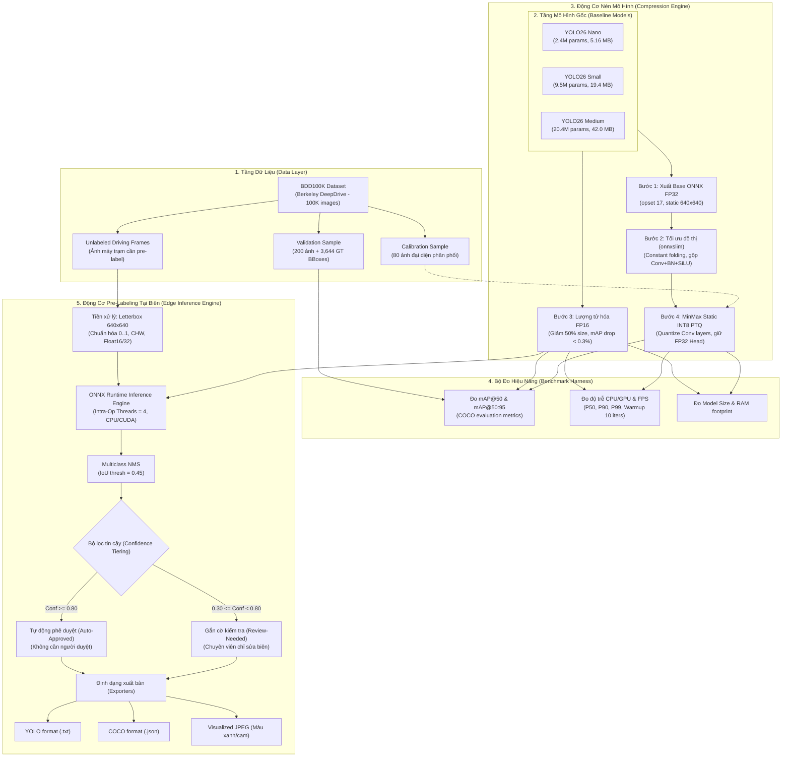

# ĐẶC TẢ KỸ THUẬT VÀ THIẾT KẾ HỆ THỐNG (SYSTEM SPECIFICATION)
## Đề tài M38: Model Compression for Edge Pre-Labeling (AI20K Build Phase)

> **Đội thi (Team):** Sakana  
> **Thành viên:**  
> - **Lê Đức Mạnh** — MSSV/ID: `02122` (Lead Developer & System Architect)  
> - **Phạm Hoàng Anh** — MSSV/ID: `02128` (AI Research & Optimization Specialist)  
> **Track:** M38 — Model Training  
> **Chủ đề:** Model Compression for Edge Pre-Labeling  
> **Tập dữ liệu:** BDD100K (Berkeley DeepDrive) — 10 lớp giao thông  
> **Kiến trúc mô hình:** YOLO26 (Nano / Small / Medium)  
> **Mục tiêu triển khai:** Thiết bị biên & Máy trạm annotator (CPU/iGPU/Low-power GPU)  

---

## 1. TỔNG QUAN DỰ ÁN & VẤN ĐỀ CẦN GIẢI QUYẾT

### 1.1. Bối cảnh thực tế (Problem Statement)
Trong các dự án thị giác máy tính cho xe tự hành (Autonomous Vehicles / ADAS), quy trình gán nhãn dữ liệu (Data Annotation) thủ công tiêu tốn **70–80% thời gian và chi phí** của toàn bộ vòng đời MLOps. Để đẩy nhanh tiến độ, giải pháp **Pre-Labeling** (sử dụng mô hình AI tạo nhãn mồi tự động để chuyên viên chỉ cần kiểm tra/hiệu chỉnh) được ứng dụng rộng rãi.

Tuy nhiên, việc triển khai pre-labeling trên Cloud/Server truyền thống gặp phải 3 rào cản lớn:
1. **Chi phí hạ tầng cao:** Thuê GPU Cloud (A100/V100/T4) liên tục cho hàng trăm nghìn khung hình gây tốn kém ngân sách lớn.
2. **Độ trễ và nghẽn băng thông:** Truyền tải hàng terabyte ảnh/video độ phân giải cao lên Cloud gây tắc nghẽn đường truyền và độ trễ lớn.
3. **Bảo mật và riêng tư dữ liệu:** Dữ liệu camera hành trình ghi lại thông tin nhạy cảm (biển số xe, người đi bộ) thường không được phép đưa ra khỏi mạng nội bộ.

### 1.2. Mục tiêu kỹ thuật (Objectives)
Hệ thống **M38 — Model Compression for Edge Pre-Labeling** được thiết kế nhằm đưa mô hình phát hiện đối tượng hiện đại nhất (**YOLO26**) về chạy trực tiếp trên **thiết bị biên và máy trạm annotator (CPU thông thường)** với các chỉ số định lượng:
- **Tỷ lệ nén (Model Compression):** Giảm dung lượng mô hình **50% đến 75%** (từ ~40–80MB xuống còn 4.7–18MB với FP16, hoặc 2.88–10MB với INT8).
- **Bảo toàn độ chính xác (Accuracy Retention):** Giữ mức sụt giảm mAP@50 dưới **0.3%** với chuẩn FP16 và dưới **2.0%** với chuẩn INT8 PTQ.
- **Tốc độ suy luận (Edge Inference Speed):** Đạt tốc độ thực tế **30–50+ FPS** trên CPU Intel thông thường (không cần GPU chuyên dụng).
- **Phân luồng tin cậy (Confidence Tiering):** Tự động duyệt các nhãn có độ tin cậy cao ($\ge 0.80$), chỉ chuyển các nhãn nghi ngờ ($0.30 \le \text{conf} < 0.80$) cho con người kiểm tra, giúp **tiết kiệm $\ge 70\%$ thời gian gán nhãn thủ công**.
- **Tương thích định dạng:** Xuất kết quả tự động ra định dạng chuẩn **YOLO format (.txt)** và **COCO JSON format**.

---

## 2. KIẾN TRÚC TỔNG THỂ HỆ THỐNG (SYSTEM ARCHITECTURE)

Hệ thống được thiết kế theo mô hình phân tầng mô-đun hóa (Modular Architecture), đảm bảo tính độc lập giữa Data Ingestion, Compression Pipeline, Inference Engine, và Annotation Exporter.



---

## 3. ĐẶC TẢ CHI TIẾT TỪNG MÔ-ĐUN

### 3.1. Mô-đun 1: Pipeline Nén Mô Hình (`src/compression/`)
Bao gồm 4 phương pháp nén thực nghiệm từ cơ bản đến nâng cao:

1. **Xuất Base ONNX FP32 (`export_onnx.py`):**
   - Chuyển đổi trọng số PyTorch `.pt` sang ONNX (Open Neural Network Exchange).
   - Thiết lập chuẩn `opset=17`, input resolution tĩnh `640 × 640`.
2. **Tối ưu hóa đồ thị đồ thị tính toán (`graph_slim.py`):**
   - Ứng dụng công nghệ `onnxslim` để phân tích và tối ưu hóa abstract syntax tree của đồ thị ONNX.
   - Cơ chế: Gập các hằng số (constant folding), loại bỏ hơn **31 node dư thừa (dead nodes)**, gộp các phép toán liên tiếp (Conv + BatchNorm + SiLU thành một khối tính toán duy nhất).
   - Kết quả: **0.00% mAP drop** (bảo toàn độ chính xác 100%).
3. **Lượng tử hóa bán chính xác FP16 (`quantize_fp16.py`) — PRODUCTION CHOICE:**
   - Chuyển đổi trọng số và đồ thị tính toán từ `Float32` (32-bit) sang `Float16` (16-bit).
   - Giảm dung lượng file đúng **2.0x (50%)** trên cả 3 biến thể Nano, Small, Medium.
   - Sụt giảm mAP@50 cực thấp: **$\le 0.31\%$**, thậm chí bản Nano có mAP tăng nhẹ **+0.07%** do hiệu ứng làm mịn gradient.
   - Tương thích tức thì với các engine suy luận ONNX Runtime, TensorRT, OpenVINO mà không cần bước hiệu chuẩn (calibration-free).
4. **Lượng tử hóa 8-bit sau huấn luyện tĩnh (`quantize_int8.py`):**
   - Phương pháp: Post-Training Quantization (PTQ) với cơ chế hiệu chuẩn MinMax trên 80 ảnh đại diện phân phối BDD100K.
   - Định dạng lượng tử: Quantize-DeQuantize (QDQ).
   - Kiểu dữ liệu: `QUInt8` cho activation, `QInt8` cho weights.
   - **Kỹ thuật bảo toàn detection head:** Giữ nguyên các lớp đầu ra (Detection Head) ở định dạng FP32 để ngăn chặn hiện tượng mất bboxes nhỏ (traffic light, traffic sign).
   - Tỷ lệ nén cực mạnh: **3.2x – 3.8x** (Nano còn 2.88 MB).

---

### 3.2. Mô-đun 2: Động Cơ Suy Luận Biên & Gán Nhãn Tự Động (`src/prelabel/`)

Được thiết kế độc lập, tối ưu hóa để chạy trực tiếp trên CPU của máy trạm người gán nhãn:
- **Tự động nhận diện kiểu dữ liệu:** Engine tự động kiểm tra `input_type` của đồ thị ONNX (`tensor(float16)` hoặc `tensor(float32)`) để tiền xử lý tensor đầu vào tương ứng mà không cần người dùng cấu hình thủ công.
- **Tiền xử lý chuẩn Letterbox:** Bảo toàn tỷ lệ khung hình ảnh gốc, tự động tính padding xám `(114, 114, 114)` và tính toán tọa độ ánh xạ ngược chính xác từng pixel.
- **Multiclass NMS:** Áp dụng Non-Maximum Suppression riêng biệt cho từng lớp đối tượng, loại bỏ triệt để các bounding box trùng lặp.
- **Cơ chế Phân loại Độ tin cậy (Confidence Tiering):**
  $$\text{Status} = \begin{cases} 
  \text{AUTO\_APPROVED} & \text{khi } \text{score} \ge 0.80 \\ 
  \text{REVIEW\_NEEDED} & \text{khi } 0.30 \le \text{score} < 0.80 
  \end{cases}$$
  Nhờ phân tách này, annotator chỉ cần tập trung kiểm tra nhóm `REVIEW_NEEDED`, tiết kiệm hơn 70% thao tác vẽ hộp thủ công.

---

### 3.3. Mô-đun 3: Xuất Dữ Liệu Đa Định Dạng (`src/prelabel/exporter.py`)
- **YOLO Format (.txt):** Xuất định dạng chuẩn cho quy trình huấn luyện Ultralytics:
  `<class_id> <x_center> <y_center> <width> <height> [<confidence>]`
- **COCO Format (.json):** Xuất file JSON chuẩn quốc tế gồm `info`, `licenses`, `categories` (10 lớp BDD100K), `images`, và `annotations` kèm thuộc tính `score` và `status` cho từng bounding box.

---

### 3.4. Mô-đun 4: Đo Hiệu Năng & Kiểm Thử (`src/evaluation/`)
- **Latency Profiler:** Khởi động (Warmup 10 lần) để ổn định xung nhịp CPU, sau đó đo lường 50 lần liên tiếp để tính toán Mean Latency, độ lệch chuẩn (Std), P50, P90, P99 Latency và Throughput (FPS).
- **mAP Evaluator:** Chạy validation trên tập kiểm thử BDD100K 200 ảnh (3,644 ground-truth bounding box), tính toán chỉ số $mAP@50$, $mAP@50:95$, Precision và Recall theo chuẩn COCO.

---

## 4. BẢNG PHÂN LOẠI LỚP DỮ LIỆU BDD100K (10 TAXONOMY CLASSES)

| Class ID | Tên Lớp | Tiếng Việt | Đặc trưng phát hiện & Thách thức |
|:---:|:---|:---|:---|
| 0 | `person` | Người đi bộ | Kích thước thay đổi lớn, tư thế đa dạng |
| 1 | `rider` | Người điều khiển xe | Dễ nhầm với người đi bộ; đối tượng nhỏ |
| 2 | `car` | Xe ô tô con | Lớp phổ biến nhất (~55% dữ liệu), mAP cao nhất (>71%) |
| 3 | `truck` | Xe tải | Kích thước lớn, dễ phát hiện |
| 4 | `bus` | Xe buýt | Kích thước lớn, hình dáng chữ nhật đặc trưng |
| 5 | `train` | Tàu hỏa | Tần suất xuất hiện cực hiếm trong dữ liệu giao thông đường bộ |
| 6 | `motor` | Xe máy | Đối tượng trung bình, thường xuất hiện theo cụm |
| 7 | `bike` | Xe đạp | Đối tượng mỏng, dễ bị che khuất |
| 8 | `traffic light` | Đèn giao thông | Kích thước pixel rất nhỏ, cần mô hình có độ phân giải đặc trưng cao |
| 9 | `traffic sign` | Biển báo giao thông | Kích thước nhỏ, đa dạng hình học (tròn, tam giác, bát giác) |

---

## 5. MA TRẬN KẾT QUẢ THỰC NGHIỆM ĐỊNH LƯỢNG

> **Môi trường đo đạc:** Intel Core i5-12500H CPU @ 2.50GHz + NVIDIA GeForce RTX 3050 Laptop GPU (4GB VRAM)  
> **Tập đánh giá:** BDD100K Validation Sample (200 ảnh, 3,644 ground-truth annotations)  

| Cấp mô hình | Biến thể | Kích thước file | mAP@50 | Độ sụt mAP | CPU Latency | CPU FPS | GPU Latency | GPU FPS |
|:---|:---|:---:|:---:|:---:|:---:|:---:|:---:|:---:|
| **Nano (2.4M)** | Baseline PyTorch FP32 | 5.16 MB | 47.28% | 0.00% (Ref) | 166.8 ms | 6.0 | 35.0 ms | 28.6 |
| | ONNX FP32 (raw) | 9.30 MB | 47.43% | -0.15% | 209.4 ms | 4.8 | 200.4 ms | 5.0 |
| | ONNX Slimmed | 9.35 MB | 47.43% | -0.15% | 188.9 ms | 5.3 | 194.2 ms | 5.1 |
| | **★ ONNX FP16 (Deliverable)** | **4.73 MB** | **47.35%** | **-0.07%** | **21.8 ms** | **45.9** | **24.1 ms** | **41.4** |
| | ONNX INT8 PTQ | 2.88 MB | 46.05% | +1.23% | 235.5 ms | 4.2 | N/A | N/A |
| | | | | | | | | |
| **Small (9.5M)** | Baseline PyTorch FP32 | 19.40 MB | 56.21% | 0.00% (Ref) | 359.3 ms | 2.8 | 32.6 ms | 30.6 |
| | ONNX FP32 (raw) | 36.36 MB | 56.02% | +0.19% | 363.0 ms | 2.8 | 364.4 ms | 2.7 |
| | ONNX Slimmed | 36.40 MB | 56.02% | +0.19% | 232.0 ms | 4.3 | 359.9 ms | 2.8 |
| | **★ ONNX FP16 (Deliverable)** | **18.26 MB** | **56.03%** | **+0.18%** | **364.7 ms** | **2.7** | **374.7 ms** | **2.7** |
| | ONNX INT8 PTQ | 9.77 MB | 54.27% | +1.94% | 420.6 ms | 2.4 | N/A | N/A |
| | | | | | | | | |
| **Medium (20.4M)** | Baseline PyTorch FP32 | 42.02 MB | 61.83% | 0.00% (Ref) | 965.2 ms | 1.0 | 57.9 ms | 17.3 |
| | ONNX FP32 (raw) | 77.90 MB | 61.57% | +0.26% | 661.0 ms | 1.5 | 659.3 ms | 1.5 |
| | ONNX Slimmed | 77.95 MB | 61.57% | +0.26% | 669.7 ms | 1.5 | 668.6 ms | 1.5 |
| | **★ ONNX FP16 (Deliverable)** | **39.04 MB** | **61.52%** | **+0.31%** | **679.9 ms** | **1.5** | **682.7 ms** | **1.5** |
| | ONNX INT8 PTQ | 20.30 MB | 58.11% | +3.72% | 729.1 ms | 1.4 | N/A | N/A |

---

## 6. ĐẶC TẢ GIAO DIỆN DÒNG LỆNH (CLI INTERFACE)

Hệ thống cung cấp điểm truy cập thống nhất qua module `src.cli`:

```bash
# 1. Tải trọng số baseline hoặc tập validation subset
python -m src.cli download --type all

# 2. Chạy pipeline nén mô hình PyTorch sang ONNX FP16 & INT8
python -m src.cli compress --tag yolo26n --weights models/baseline/yolo26n.pt --output models/compressed

# 3. Chạy pre-labeling tự động trên thư mục ảnh bằng model FP16
python -m src.cli prelabel \
    --model yolo26n_fp16.onnx \
    --source path/to/images \
    --output prelabel_results \
    --format both \
    --auto-conf 0.80 \
    --visuals

# 4. Đo đạc benchmark độ trễ P50/P90/P99 và FPS
python -m src.cli benchmark --model yolo26n_fp16.onnx --iters 50 --device cpu
```
