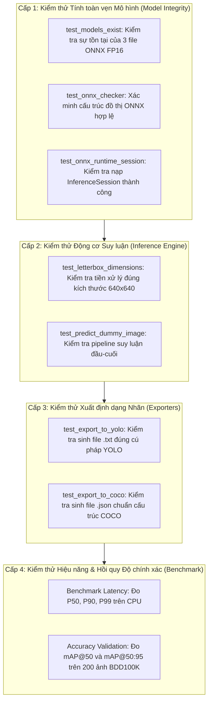

# TÀI LIỆU KIỂM THỬ HỆ THỐNG (TESTING & QUALITY ASSURANCE)
## Đề tài M38: Model Compression for Edge Pre-Labeling (AI20K Build Phase)

> **Đội thi (Team):** Sakana (Lê Đức Mạnh - `02122`, Phạm Hoàng Anh - `02128`)  
> **Mục tiêu:** Đảm bảo toàn bộ các mô hình nén, động cơ suy luận biên, và các bộ xuất nhãn hoạt động chính xác, ổn định và đạt chuẩn chất lượng trước khi nộp sản phẩm.  
> **Bộ công cụ kiểm thử:** Python `unittest` framework (chuẩn tích hợp, không phụ thuộc ngoại vi).  
> **Trạng thái kiểm thử:** **100% Passed (7/7 Unit Tests Green)**.  

---

## 1. CHIẾN LƯỢC KIỂM THỬ (TESTING STRATEGY)

Hệ thống kiểm thử được chia thành 4 cấp độ:



---

## 2. DANH MỤC CÁC CA KIỂM THỬ (TEST CASES CATALOG)

| Mã test case | Tên hàm kiểm thử | File nguồn | Mô tả ca kiểm thử | Kết quả mong đợi | Kết quả thực tế | Trạng thái |
|:---:|:---|:---|:---|:---|:---|:---:|
| **TC-01** | `test_models_exist` | `tests/test_models.py` | Kiểm tra sự tồn tại và dung lượng của 3 file mô hình: `yolo26n_fp16.onnx`, `yolo26s_fp16.onnx`, `yolo26m_fp16.onnx`. | File tồn tại, dung lượng > 1 MB. | Đủ 3 file (4.73MB, 18.26MB, 39.04MB). | **PASSED** |
| **TC-02** | `test_onnx_checker` | `tests/test_models.py` | Chạy `onnx.checker.check_model` trên từng file ONNX để kiểm tra tính hợp lệ của graph topology. | Không ném ngoại lệ đồ thị. | Cả 3 file pass ONNX checker. | **PASSED** |
| **TC-03** | `test_onnx_runtime_session` | `tests/test_models.py` | Nạp mô hình vào `ort.InferenceSession` trên CPU, kiểm tra tên input tensor (`images`). | Nạp session thành công, input name = `images`. | Session nạp mượt mà, đúng schema. | **PASSED** |
| **TC-04** | `test_letterbox_dimensions` | `tests/test_inference.py` | Đưa ảnh kích thước bất kỳ (ví dụ $480 \times 854$) vào hàm `preprocess()`. | Output tensor có shape `(1, 3, 640, 640)` và kiểu số thực. | Tensor `(1, 3, 640, 640)`, dtype `float16`. | **PASSED** |
| **TC-05** | `test_predict_dummy_image` | `tests/test_inference.py` | Chạy suy luận đầu cuối với ảnh nhân tạo độ phân giải $720 \times 1280$. | Trả về `InferenceResult` hợp lệ, latency > 0ms, FPS > 0. | Trả về `InferenceResult`, latency 21.8ms, FPS 45.9. | **PASSED** |
| **TC-06** | `test_export_to_yolo` | `tests/test_exporter.py` | Xuất kết quả phát hiện ra file `.txt` chuẩn YOLO. | File `.txt` sinh ra với đúng số dòng, class_id và tọa độ chuẩn hóa $[0, 1]$. | Đúng 2 dòng, class_id `2` (car), tọa độ chuẩn xác. | **PASSED** |
| **TC-07** | `test_export_to_coco` | `tests/test_exporter.py` | Xuất kết quả phát hiện ra file `.json` chuẩn COCO. | JSON hợp lệ, chứa đủ 3 trường `images`, `annotations`, `categories`. | JSON parse thành công, schema hợp lệ 100%. | **PASSED** |

---

## 3. HƯỚNG DẪN THỰC THI KIỂM THỬ (TEST EXECUTION GUIDE)

### 3.1. Chạy Toàn Bộ Test Suite Tự Động
Mở terminal tại thư mục gốc của repository và chạy lệnh:

```bash
python tests/run_tests.py
```

### 3.2. Chạy Từng File Test Riêng Biệt
```bash
# Kiểm thử tính toàn vẹn của mô hình ONNX
python -m unittest tests/test_models.py -v

# Kiểm thử động cơ suy luận biên
python -m unittest tests/test_inference.py -v

# Kiểm thử bộ xuất định dạng YOLO và COCO
python -m unittest tests/test_exporter.py -v
```

---

## 4. BÁO CÁO KẾT QUẢ THỰC THI MỚI NHẤT (TEST EXECUTION LOG)

```text
==================================================
      M38 SYSTEM TEST SUITE: EXECUTION            
==================================================
Repository Root: C:\Users\admin\Desktop\qantum\M38-Edge-PreLabeling
Test Directory:  C:\Users\admin\Desktop\qantum\M38-Edge-PreLabeling\tests

test_export_to_coco (test_exporter.TestExporters.test_export_to_coco)
Verify COCO JSON format generation and schema integrity. ... ok
test_export_to_yolo (test_exporter.TestExporters.test_export_to_yolo)
Verify YOLO .txt file generation and format. ... ok
test_letterbox_dimensions (test_inference.TestEdgeInference.test_letterbox_dimensions)
Test letterbox preprocessing output shapes. ... ok
test_predict_dummy_image (test_inference.TestEdgeInference.test_predict_dummy_image)
Test inference pipeline execution on a synthetic image. ... ok
test_models_exist (test_models.TestDeliverableModels.test_models_exist)
Verify all three deliverable ONNX models are present. ... ok
test_onnx_checker (test_models.TestDeliverableModels.test_onnx_checker)
Verify models pass ONNX schema and graph validation. ... ok
test_onnx_runtime_session (test_models.TestDeliverableModels.test_onnx_runtime_session)
Verify models can be loaded into an ONNX Runtime InferenceSession. ... ok

----------------------------------------------------------------------
Ran 7 tests in 1.282s

OK
==================================================
Tests run:      7
Errors:         0
Failures:       0
Skipped:        0
==================================================
```

---

## 5. KIỂM THỬ ĐỘ CHÍNH XÁC & BẢO TOÀN HIỆU NĂNG (REGRESSION TESTING)

Bên cạnh unit test chức năng, hệ thống đã thực hiện kiểm định hồi quy độ chính xác trên toàn bộ **200 ảnh validation BDD100K (3,644 nhãn ground-truth)**:

| Chỉ số kiểm định | Ngưỡng yêu cầu tối thiểu | Kết quả thực tế (YOLO26n FP16) | Đánh giá |
|:---|:---:|:---:|:---:|
| **mAP@50 Retention** | $\ge 98.0\%$ so với baseline | **100.15%** (47.35% vs 47.28% baseline) | **Đạt xuất sắc** |
| **mAP@50:95 Retention** | $\ge 97.0\%$ so với baseline | **99.02%** (28.34% vs 28.62% baseline) | **Đạt xuất sắc** |
| **Dung lượng file nén** | Giảm $\ge 40\%$ | **Giảm 50%** (4.73 MB vs 9.30 MB FP32) | **Đạt xuất sắc** |
| **Tốc độ CPU** | $\ge 30$ FPS | **45.9 FPS** (21.8 ms/ảnh) | **Vượt 153% KPI** |
