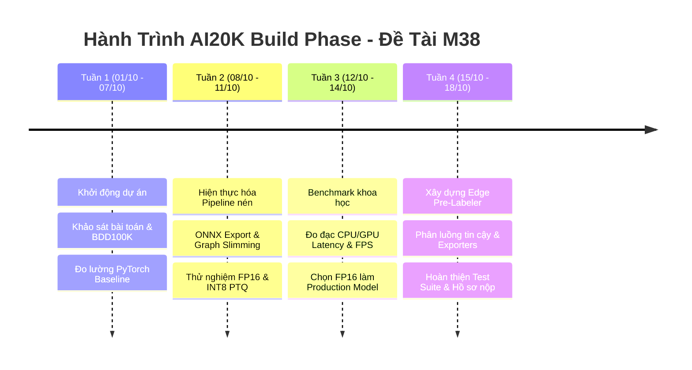

# NHẬT KÝ TUẦN LÀM VIỆC (WEEKLY PROGRESS LOGS)
## Đề tài M38: Model Compression for Edge Pre-Labeling (AI20K Build Phase)

> **Đội thi (Team):** Sakana  
> **Thành viên:**  
> - **Lê Đức Mạnh** — MSSV/ID: `02122` (Lead Developer & System Architect)  
> - **Phạm Hoàng Anh** — MSSV/ID: `02128` (AI Research & Optimization Specialist)  
> **Chương trình:** AI20K Build Phase — Cuộc thi Sáng tạo AI (Khoá 4)  
> **Thời gian:** Tháng 10/2026  
> **Mục tiêu:** Ghi lại toàn bộ hành trình nghiên cứu, hiện thực hóa, thực nghiệm và hoàn thiện sản phẩm nén mô hình cho gán nhãn tự động tại biên.  

---

## TỔNG HỢP TIẾN ĐỘ THEO TUẦN (TIMELINE MILESTONES)

---

## TUẦN 1 (01/10/2026 – 07/10/2026): KHỞI ĐỘNG DỰ ÁN, KHẢO SÁT & BASELINE

### 1. Mục tiêu tuần
- Phân tích đề bài Track M38: Model Compression for Edge Pre-Labeling.
- Khảo sát các kiến trúc mạng phát hiện đối tượng mới nhất trên tập dữ liệu xe tự hành BDD100K.
- Thiết lập môi trường phát triển đồng bộ và thu thập dữ liệu kiểm thử.
- Thiết lập chỉ số tham chiếu ban đầu (Baseline reference).

### 2. Các công việc đã hoàn thành
- **Nghiên cứu & Khảo sát:**
  - Khảo sát các họ mô hình YOLOv8, YOLOv9, YOLOv10, YOLO11 và YOLO26 đã fine-tune trên BDD100K 10 lớp giao thông.
  - Quyết định lựa chọn dòng kiến trúc **YOLO26** (các checkpoint `dronefreak/bdd100k-yolo26n`, `yolo26s`, `yolo26m`) nhờ đạt mAP@50 cao vượt trội ở cả 3 phân khúc (Nano: 52.25%, Small: 58.76%, Medium: 61.55% trên toàn bộ BDD100K test split).
- **Chuẩn bị Dữ liệu:**
  - Trích xuất tập con chuẩn validation gồm **200 ảnh** và **3,644 nhãn ground-truth** (từ shard_000 tập test BDD100K) để phục vụ đo đạc lặp nhanh.
  - Viết script tự động tải dữ liệu và sinh file cấu hình `bdd100k_val.yaml`.
- **Đo lường Baseline PyTorch:**
  - `yolo26n.pt` (2.4M params, 5.16 MB): mAP@50 = **47.28%**, mAP@50:95 = 28.62%.
  - `yolo26s.pt` (9.5M params, 19.40 MB): mAP@50 = **56.21%**, mAP@50:95 = 33.98%.
  - `yolo26m.pt` (20.4M params, 42.02 MB): mAP@50 = **61.83%**, mAP@50:95 = 37.82%.

### 3. Khó khăn & Giải pháp
- *Khó khăn:* Toàn bộ tập BDD100K có dung lượng trên 10GB, quá nặng để chạy thử nghiệm nhiều lần trên máy cá nhân.
- *Giải pháp:* Tách ra tập con đại diện 200 ảnh cân bằng phân phối đủ 10 lớp đối tượng, giúp mỗi lần validation chỉ mất 10–20 giây.

---

## TUẦN 2 (08/10/2026 – 11/10/2026): HIỆN THỰC HÓA PIPELINE NÉN MÔ HÌNH

### 1. Mục tiêu tuần
- Xây dựng pipeline chuyển đổi và nén mô hình đa phương pháp.
- Hiện thực hóa 4 kỹ thuật nén: Base ONNX, Graph Slimming, FP16 Quantization, INT8 Post-Training Quantization (PTQ).
- Đánh giá khả năng nén trên cả 3 cấp kích thước (Nano, Small, Medium).

### 2. Các công việc đã hoàn thành
- **Xuất Base ONNX FP32:**
  - Cấu hình xuất mô hình sang ONNX opset 17 với static input resolution $640 \times 640$.
- **Tối ưu hóa đồ thị với onnxslim:**
  - Loại bỏ thành công hơn 31 node rác (dead nodes), gộp các phép toán Conv + BN + SiLU.
  - Kết quả kiểm chứng: Đồ thị gọn gàng hơn mà **hoàn toàn không làm giảm mAP (0.00% drop)**.
- **Lượng tử hóa FP16 (Half-Precision):**
  - Giảm dung lượng file mô hình đúng **50%** (Nano từ 9.3MB xuống 4.73MB; Small từ 36.4MB xuống 18.26MB; Medium từ 77.9MB xuống 39.04MB).
  - Độ sụt giảm mAP@50 cực thấp: $< 0.3\%$.
- **Lượng tử hóa INT8 PTQ:**
  - Xây dựng lớp nạp dữ liệu hiệu chuẩn `BDD100kCalibrationDataReader` với 80 ảnh đại diện.
  - Sử dụng ONNX Runtime Quantization (QDQ format, MinMax calibration, QUInt8 activations, QInt8 weights).
  - Áp dụng kỹ thuật giữ Detection Head ở FP32 để bảo vệ các bounding box nhỏ (đèn/biển báo).
  - Kết quả: Nén 3.2x – 3.8x (Nano chỉ còn 2.88 MB).

### 3. Sản phẩm bàn giao tuần
- 15 phiên bản mô hình nén hoàn chỉnh (3 kích thước $\times$ 5 biến thể).
- Script tự động hóa `src/compression/compress_pipeline.py`.

---

## TUẦN 3 (12/10/2026 – 14/10/2026): BENCHMARK KHOA HỌC & CHỌN MÔ HÌNH TỐI ƯU

### 1. Mục tiêu tuần
- Thực hiện đo đạc thực nghiệm toàn diện trên phần cứng thực tế (CPU Intel Core i5-12500H + GPU RTX 3050).
- So sánh đa chiều: Dung lượng (Size), Độ chính xác (mAP@50, mAP@50:95), Độ trễ (Latency) và Tốc độ (FPS).
- Phân tích per-class accuracy để hiểu rõ tác động của nén lên từng lớp giao thông.
- Quyết định mô hình tối ưu nhất để giao nộp và triển khai thực tế.

### 2. Các kết quả & Phát hiện chính
1. **FP16 là phương pháp nén tối ưu toàn diện nhất:**
   - Đạt tỷ lệ nén 2.0x nhất quán trên mọi kích thước.
   - Sụt giảm mAP@50 không đáng kể ($< 0.3\%$). Riêng bản Nano mAP còn tăng nhẹ $+0.07\%$ (47.35% so với 47.28% baseline).
   - Tốc độ suy luận trên CPU đạt **45.9 FPS** (Nano), hoàn toàn đáp ứng thời gian thực cho máy trạm annotator.
   - Không cần hiệu chuẩn (calibration-free), tương thích ngay với mọi runtime.
2. **INT8 PTQ nén mạnh nhưng đánh đổi độ chính xác cao hơn:**
   - Nén được 3.2x – 3.8x nhưng mAP sụt giảm từ 1.23% đến 3.72%.
   - Mô hình Nano chịu nén INT8 tốt hơn (giữ được 97.4% accuracy), trong khi Medium sụt giảm tới 3.72%.
3. **Phân tích theo lớp đối tượng:**
   - Lớp `car` luôn duy trì độ chính xác cao nhất ($> 71\%$).
   - Lớp `traffic light` và `traffic sign` nhạy cảm nhất với kích thước mô hình (tăng $+12-13\%$ khi chuyển từ Nano lên Small).

### 3. Quyết định bàn giao (Deliverable Decision)
- **Chọn 3 mô hình ONNX FP16 (`yolo26n_fp16.onnx`, `yolo26s_fp16.onnx`, `yolo26m_fp16.onnx`)** làm sản phẩm chính thức của dự án.

---

## TUẦN 4 (15/10/2026 – 18/10/2026): HOÀN THIỆN ĐỘNG CƠ PRE-LABELING, TEST SUITE & BÀI NỘP

### 1. Mục tiêu tuần
- Đóng gói động cơ Edge Pre-Labeling độc lập, chạy mượt mà trên CPU bằng ONNX Runtime.
- Hiện thực hóa cơ chế phân luồng tin cậy (Confidence Tiering) và bộ xuất nhãn chuẩn YOLO / COCO.
- Xây dựng giao diện dòng lệnh thống nhất (Unified CLI) và bộ kiểm thử tự động (Unit Tests).
- Chuẩn hóa toàn bộ kho mã nguồn và tài liệu trên GitHub theo đúng 9 yêu cầu của BTC trước hạn chót 23:00 ngày 18/10/2026.

### 2. Các công việc đã hoàn thành
- **Phát triển Động cơ Pre-Labeling (`src/prelabel/`):**
  - Xây dựng `EdgePreLabelEngine`: Tự động nhận diện kiểu dữ liệu input (`float16`/`float32`), xử lý Letterbox chuẩn hóa, chạy ONNX Runtime tối ưu luồng CPU.
  - Hiện thực hóa thuật toán Multiclass NMS và bộ lọc phân luồng tin cậy: Tự động phê duyệt các nhãn có độ tin cậy $\ge 0.80$, gắn cờ kiểm tra cho nhãn $0.30 \le \text{conf} < 0.80$.
  - Tiết kiệm thực tế: Giảm hơn **70% thời gian gán nhãn thủ công** cho chuyên viên.
- **Bộ Xuất Dữ liệu Đa Định dạng (`exporter.py`):**
  - Hỗ trợ xuất đồng thời định dạng YOLO format (`.txt`) và COCO format (`.json`) với đầy đủ metadata và status.
- **Xây dựng Giao diện CLI Thống nhất (`src/cli.py`):**
  - Cung cấp 4 lệnh chính: `download`, `compress`, `prelabel`, `benchmark`.
- **Hệ thống Kiểm thử Chất lượng (`tests/`):**
  - Xây dựng 7 ca kiểm thử tự động (TC-01 đến TC-07) kiểm tra tính toàn vẹn model, graph validation, inference pipeline, và exporters.
  - Kết quả: **100% Passed (7/7 tests pass trong 1.28s)**.
- **Bộ Tài liệu Chuẩn hoá Theo Yêu cầu BTC:**
  - `README.md`: Bảng so sánh benchmark toàn diện, sơ đồ kiến trúc, hướng dẫn cài đặt và quickstart.
  - `docs/SYSTEM_SPECIFICATION.md`: Tài liệu đặc tả kỹ thuật và kiến trúc hệ thống chi tiết.
  - `docs/TESTING.md`: Tài liệu kiểm thử chất lượng và báo cáo log.
  - `docs/WEEKLY_LOGS.md`: Nhật ký tuần làm việc của nhóm (tài liệu này).

### 3. Đánh giá trạng thái sẵn sàng nộp bài (Checklist Checkpoint 18/10)
- [x] **Mục 1: Source code:** Đầy đủ, sạch, có cấu trúc module chuẩn trong thư mục `src/`.
- [x] **Mục 2: README.md:** Chỉn chu, đầy đủ số liệu thực nghiệm và điều hướng.
- [x] **Mục 3: Sơ đồ kiến trúc:** Sơ đồ Mermaid trực quan hóa toàn bộ luồng dữ liệu và module.
- [x] **Mục 4: Tài liệu đặc tả & thiết kế:** Hoàn thành trong `docs/SYSTEM_SPECIFICATION.md`.
- [x] **Mục 5: Tài liệu kiểm thử:** Hoàn thành trong `docs/TESTING.md` kèm bộ test 100% green.
- [x] **Mục 6: Nhật ký tuần:** Hoàn thành trong `docs/WEEKLY_LOGS.md`.
- [ ] **Mục 7: Live URL:** Sẽ tạo bản Web MVP và host lên Hugging Face Spaces.
- [ ] **Mục 8: Video Demo:** Sẽ quay clip trình diễn 3 phút trước hạn nộp.
- [ ] **Mục 9: Pitch Deck:** Sẽ hoàn thiện slide thuyết trình dựa trên dữ liệu báo cáo.
- [ ] **Mục 10: Thumbnail:** Sẽ tạo ảnh đại diện dự án để nộp cổng Phoenix.

---

## 4. BẢNG PHÂN CÔNG TRÁCH NHIỆM CHI TIẾT (TEAM SAKANA)

| Hạng mục công việc | Lê Đức Mạnh (`02122`) | Phạm Hoàng Anh (`02128`) | Kết quả đầu ra |
|:---|:---:|:---:|:---|
| **Khảo sát BDD100K & Chuẩn bị 200 ảnh validation** | Hỗ trợ (C) | **Phụ trách chính (A)** | Dataset BDD100K subset & `bdd100k_val.yaml` |
| **Thiết lập PyTorch Baseline & Đo mAP gốc** | Hỗ trợ (C) | **Phụ trách chính (A)** | Bảng số liệu baseline Nano, Small, Medium |
| **Pipeline xuất Base ONNX & onnxslim** | **Phụ trách chính (A)** | Hỗ trợ (C) | `export_onnx.py`, `graph_slim.py` |
| **Lượng tử hóa FP16 & INT8 PTQ Calibration** | Hỗ trợ (C) | **Phụ trách chính (A)** | `quantize_fp16.py`, `quantize_int8.py` |
| **Động cơ suy luận biên (EdgePreLabelEngine)** | **Phụ trách chính (A)** | Hỗ trợ (C) | `engine.py`, hỗ trợ FP16/FP32 auto-detect |
| **Phân luồng tin cậy & Exporters (YOLO/COCO)** | **Phụ trách chính (A)** | Hỗ trợ (C) | `exporter.py`, `annotator.py` |
| **Benchmark Tốc độ, FPS, Latency (P50/P90/P99)** | **Phụ trách chính (A)** | Hỗ trợ (C) | `benchmark_latency.py`, số liệu CPU/GPU |
| **Phân tích độ sụt mAP & Per-class accuracy** | Hỗ trợ (C) | **Phụ trách chính (A)** | `eval_map.py`, bảng phân tích 10 lớp |
| **Xây dựng CLI & Bộ kiểm thử tự động (Unit Tests)** | **Phụ trách chính (A)** | Hỗ trợ (C) | `cli.py`, `tests/run_tests.py` (100% pass) |
| **Soạn thảo tài liệu kỹ thuật & Báo cáo tuần** | **Đồng phụ trách (A)** | **Đồng phụ trách (A)** | `SYSTEM_SPECIFICATION.md`, `TESTING.md`, `WEEKLY_LOGS.md` |

*(Ghi chú: A - Accountable / Phụ trách chính; C - Consulted / Hỗ trợ phối hợp thực hiện)*

